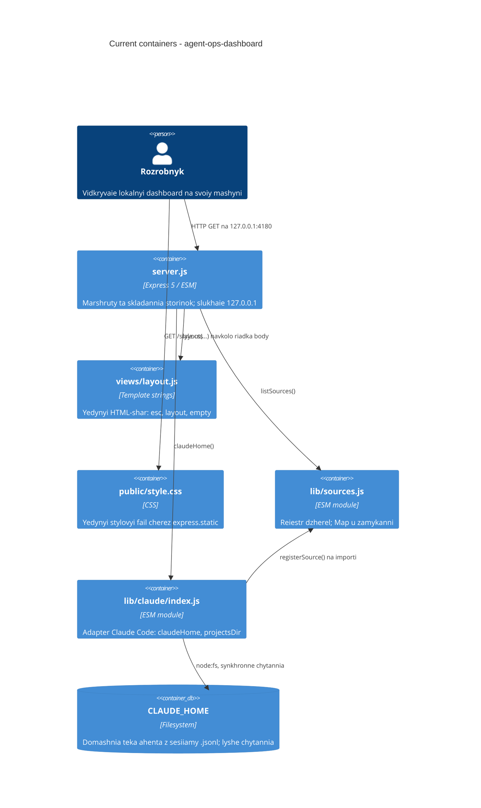

# Architecture map — agent-ops-dashboard

> **Поточна** архітектура, тобто те, що є на диску сьогодні. Мапу будує `survey`, а читають
> `specify`, `design`, `data-model` й `implement`, щоб не сканувати репозиторій заново. Оновлюй
> через `survey`, коли код відійшов від `reflects_commit`. Авторські документи (`AGENTS.md`,
> `CONTEXT.md`, `views/AGENTS.md`, `.claude/rules/*`) головніші за цю мапу; тут вони звірені, а не
> замінені.

## Stack

- Мова й рантайм: JavaScript, ESM (`package.json:5`), Node `>=22` (`package.json:7-9`, `.nvmrc`).
- Фреймворк: Express `^5.1.0` (`package.json:18-20`). Це єдина залежність; dev-залежностей нуль.
- Тести: вбудований `node:test` плюс `node:assert/strict` (`test/skeleton.test.js:1-2`).
- Команди (`package.json:10-17`):
  - `npm run verify` → `node --test --test-reporter=spec "test/*.test.js"` — ворота.
  - `npm run demo` → сервер на фікстурах, порт 4180; `npm start` / `npm run dev` — на справжній `~/.claude`.
  - `preverify` і `predemo` ганяють `scripts/pin-fixture-mtimes.mjs`, бо git не зберігає mtime.
- Збірки немає, лінтера немає (`package.json:10-17` не має ні `build`, ні `lint`; `AGENTS.md`
  §Запуск і перевірки прямо каже, що ворота це тести).

## C4 — система як вона є

## Module inventory

| Module | Path | Layers | Wired at | Responsibility |
|---|---|---|---|---|
| app | `server.js` | app / http | `server.js:9-24` | Express-застосунок, маршрути `GET /api/health` і `GET /`, статика |
| sources registry | `lib/sources.js` | ports | `server.js:5` | `registerSource` / `getSource` / `listSources` над `Map` у замиканні (`lib/sources.js:10`) |
| claude adapter | `lib/claude/index.js` | infra | `server.js:4` (імпорт заради реєстрації) | `claudeHome()`, `projectsDir()`; реєструє себе на імпорті (`lib/claude/index.js:14-18`) |
| views | `views/layout.js` | ui | `server.js:6` | `esc`, `layout`, `empty`; нічого не імпортує (`views/AGENTS.md` §Залежності) |
| styles | `public/style.css` | ui | `server.js:11` | єдиний стиль, віддається `express.static` |
| tests | `test/` | test | `npm run verify` | `*.test.js` ворота; `helpers.js` піднімає сервер, `oracle.js` рахує факти з диска |
| scripts | `scripts/` | tooling | `package.json:12-15` | `pin-fixture-mtimes.mjs`, `demo.mjs`, `verify-hook.mjs` |
| fixtures | `fixtures/claude-home/` | test data | `test/helpers.js:9` | синтетична домашня тека агента |

## Conventions (cited — правила, під які має лягти нова фіча)

- **Реєстрація модулів:** адаптер сам себе реєструє на імпорті — `lib/claude/index.js:14-18`. Автопошуку немає: новий адаптер треба ще й імпортувати в `server.js` (`server.js:4`), інакше `listSources()` мовчки його не покаже (`lib/sources.js:1-8`).
- **Обробка помилок:** `throw new Error('текст')`, без кодів і власних класів — `lib/sources.js:14`. `catch` пишемо без привʼязки до змінної і з дефолтом замість прокидання: `test/oracle.js:17`.
- **Іменування / ID:** джерело має рядковий `id` (`lib/claude/index.js:15`); сесія це UUID в імені файлу `<sessionId>.jsonl`; проєкт це закодований шлях у назві теки (`CONTEXT.md` §Glossary).
- **Доступ до даних:** синхронний `node:fs` (`readdirSync`, `lstatSync`, `readFileSync`) — `test/oracle.js:3`. `node:fs/promises` у репо немає.
- **Міграції:** немає — бази даних немає, схеми немає, нумерованих файлів немає (`AGENTS.md` §agent-ops-dashboard).
- **Тести:** `node:test` + `node:assert/strict`, сервер через `startServer()` на `app.listen(0)` — `test/skeleton.test.js:1-6`, `test/helpers.js:11-16`. Імпорт `test/helpers.js` сам ставить `CLAUDE_HOME` на фікстури (`test/helpers.js:9`). Підрахунки з диска йдуть через `test/oracle.js`, бо CI ганяє Windows без `find` / `grep` / `jq` (`test/oracle.js:1-2`).
- **Міжмодульний звʼязок:** прямі named-імпорти, жодних класів і DI; стан у замиканні (`lib/sources.js:10`). Тільки named exports (`lib/sources.js:12`, `views/layout.js:3`).
- **Вбудовані модулі:** завжди з префіксом `node:` — `lib/claude/index.js:2-3`.
- **UI / стилі:** без фреймворка. Сторінка це рядок HTML у `layout()` (`server.js:18-23`), значення з даних проходять через `esc()` (`views/layout.js:3-9`), стилі лише в `public/style.css`. Деталі нижче в §Frontend.

## Datastores

| Store | Engine | Accessed via | Notes |
|---|---|---|---|
| `CLAUDE_HOME` | файлова система | `lib/claude/index.js:6-12` (`claudeHome()`, `projectsDir()`), далі синхронний `node:fs` | Тільки читання. Дефолт `~/.claude`, override через env. Структура: `projects/<encoded-path>/<sessionId>.jsonl`; вкладені транскрипти сесіями не є (`CONTEXT.md` §Glossary) |
| `fixtures/claude-home/` | файлова система | `test/helpers.js:9`, `scripts/demo.mjs` | Синтетичні сесії для тестів і `npm run demo`; єдина тека, яку репо змінює (`scripts/pin-fixture-mtimes.mjs`) |

Реляційної бази, кешу й черг немає.

## Frontend / UI foundation

- **Компонентна бібліотека / дизайн-система:** власна, мінімальна. Весь шар це `views/layout.js` з трьома функціями: `esc`, `layout`, `empty` (`views/layout.js:3-37`, карта в `views/AGENTS.md`).
- **Дизайн-токени:** CSS custom properties у `:root` — `public/style.css:1-11`: `--bg`, `--panel`, `--line`, `--text`, `--muted`, `--accent`, `--bad`, `--good`, `--warm`. Тема темна, одна.
- **Підхід до стилів:** ванільний CSS, один файл, віддається `express.static` (`server.js:11`), підключається рядком `<link rel="stylesheet" href="/style.css">` у `layout()` (`views/layout.js:19`). Імпорту стилів у JS немає.
- **Спільні примітиви:** `layout({ title, body, nav, head })` — каркас документа з `<header class="top">` і `<main>` (`views/layout.js:11-33`); `empty(message)` — порожній стан (`views/layout.js:35-36`); таблиця зі стилями `th/td`, hover і `class="num"` для чисел (`public/style.css:32-38`); шрифт `ui-monospace` (`public/style.css:17`).
- **Стан / завантаження даних:** немає. Гідратації, клієнтського JS і збірки фронтенду немає; сторінка рендериться на сервері цілком.
- **Найближчий UI-прецедент:** `GET /` (`server.js:17-24`) — рядок body з `<h1>`, `
` і `empty()`, загорнутий у `layout()` і відданий через `res.type('html').send(...)`.
- **Обмеження:** CSP у `layout()` (`views/layout.js:17`) забороняє inline-стилі, inline-скрипти й зовнішні ресурси. Послаблювати її не можна без рішення людини (`AGENTS.md` §Межі, `.claude/rules/views.md`).

## Where things live / closest precedents

- Нове **джерело** (другий агент) → `lib/<vendor>/index.js`, за зразком `lib/claude/index.js:14-18`, плюс рядок імпорту в `server.js:4`.
- Новий **JSON-маршрут** → `server.js`, за зразком `GET /api/health` (`server.js:13-15`); тест за зразком `test/skeleton.test.js:8-13`.
- Нова **сторінка** → рядок body в `server.js` + `layout()`, за зразком `GET /` (`server.js:17-24`); значення через `esc()`, порожній стан через `empty()`. Складніша сторінка виносить свою функцію в окремий файл `views/<page>.js` (`views/AGENTS.md` §Залежності: шлях той самий, рядок → `layout()` → `res.send()`).
- Новий **тест** → `test/<name>.test.js`, імпорт `test/helpers.js` першим, факти з диска через `test/oracle.js` (`test/oracle.js:9-24`).
- Нове **читання з диска** → функція в адаптері `lib/claude/index.js`, синхронний `node:fs`.

## Constraints & known tech-debt

- **Домашня тека агента лише для читання.** Застосунок не пише в `CLAUDE_HOME` (`AGENTS.md` §Межі). Єдиний виняток `scripts/pin-fixture-mtimes.mjs` над фікстурами.
- **Переліки з метаданих.** Імʼя, розмір, mtime; вміст JSONL читаємо тільки там, де фіча прямо цього вимагає (`AGENTS.md` §Межі).
- **Текст розмов нікуди не потрапляє** — ні в репозиторій, ні в фікстури, ні в логи.
- **CSP і привʼязку до `127.0.0.1`** не послаблювати (`views/layout.js:17`, `server.js:28`).
- **Нових залежностей не додаємо**, зараз рівно одна (`package.json:18-20`).
- **Немає лінтера** — `lint_cmd` порожній, ворота це `npm run verify`. Увімкнений lint-gate без команди буде хибним червоним.
- **Кросплатформність тестів:** CI ганяє Linux, macOS і Windows, тому shell-утиліт (`find`, `grep`, `wc`, `jq`) у тестах бути не може (`test/oracle.js:1-2`).
- **mtime і git:** перед тестами треба `node scripts/pin-fixture-mtimes.mjs`, інакше дати всіх сесій злипнуться (`package.json:12,15`).
- **Адаптер неповний:** контракт у `lib/sources.js:7-8` називає `listSessions()` і `readSession(id)`, але `lib/claude/index.js:14-18` реєструє лише `id`, `label`, `home`. Валідація в `registerSource` вимагає лише ці три поля (`lib/sources.js:13`). Перша фіча роадмапи (`session-index`) закриває `listSessions()`.
- **Відновлення шляху проєкту** з закодованої назви теки однозначно неможливе; людині показуємо похідний шлях із позначкою (`CONTEXT.md` §Glossary).
- **Вкладені транскрипти:** під текою сесії лежать `subagents/` і подібне; це не сесії, тому обхід має тримати рівно глибину 2, як `exactDepth` в `test/oracle.js:9,19`.

## Reconciliation with the authored architecture doc

Окремого `docs/architecture.md` чи `ARCHITECTURE.md` у репозиторії немає, ADR-теки теж немає. Авторські документи, з якими ця мапа звірена і які лишаються головними:

- `AGENTS.md` (через `CLAUDE.md`) — конвенції, межі, карта тек. Розбіжностей не знайдено.
- `CONTEXT.md` — словник домену (розробник, джерело, проєкт, сесія, індекс сесій).
- `views/AGENTS.md` — карта HTML-шару; збігається з `views/layout.js`.
- `.claude/rules/javascript.md`, `.claude/rules/tests.md`, `.claude/rules/views.md` — технічні правила зон; розділ Conventions вище їх повторює з цитатами, а не замінює.
- `docs/roadmap.md` — що будуємо далі; перший крок `session-index` уже має теку `docs/features/session-index/` з `.size` і `.route`.

Дві нотатки з останнього оновлення:

- Правила зон переїхали: старий `docs/rules/session-data.md` і його дзеркало видалені, натомість діють `.claude/rules/javascript.md`, `.claude/rules/tests.md`, `.claude/rules/views.md` плюс `.cursor/rules/*.mdc` (коміт `2470d77`). Розділ Conventions вище цитує вже нові правила.
- `AGENTS.md` більше не згадує цю мапу: коміт `7ebfee8` прибрав абзац про `survey` і `reflects_commit` разом із самим файлом, бо в стартовому наборі мапи не має бути — її створює учень на уроці 2. Тобто мапа тепер живе поза каноном інструкцій, і при розбіжності джерело правди це код і `AGENTS.md`.
