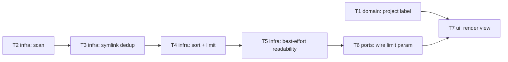

# Epic — session-index

> **Spec:** [spec.md](../spec.md) · **Design:** [sad.md](../sad.md) · **ADRs:** [adr/](../adr/)

## Goal

Add a session index to the dashboard's home page: every session across every project, built purely from file metadata, sorted newest-first, and capped by a limit — closing the first step of the roadmap and unblocking steps 2 (session view) and 3 (token cost), which both start from a row in this list.

## Scope

- **In:** `lib/claude/index.js` (`listSessions()` — scan, symlink dedup, sort, limit, best-effort readability), `server.js` (`GET /` reads and validates `?limit`), `views/session-index.js` (new render module).
- **Out:** session content view (roadmap step 2), token cost (step 3), a second source adapter (step 4), any field computed from JSONL content, search/filter/pagination/other sort columns (spec §3 non-goals).

## Task map

## Tasks

See [tracker.md](./tracker.md) for status. Machine contract: [tasks.json](../tasks.json).

| # | Task | Layer | Blocked by | DoD (short) |
|---|---|---|---|---|
| T1 | Derive a project label from the encoded project directory name | domain | — | AC-02/AC-02b unit tests pass, pure function |
| T2 | Scan projects/ two levels deep and collect raw session records | infra | — | 6 fixture sessions found, no nested/symlinked entries counted |
| T3 | Deduplicate project-dir symlinks by realpath and reject external targets | infra | T2 | AC-09/AC-09b pass, finite time on a symlink cycle |
| T4 | Sort sessions by mtime desc with filename tie-break and truncate to limit | infra | T3 | AC-03/AC-03b/AC-04 pass, deterministic tie-break |
| T5 | Make the scan best-effort: skip unreadable entries, count them, never throw | infra | T4 | AC-06/AC-07/AC-08 pass, zero writes, ≤50ms on fixtures |
| T6 | Wire GET / to read, validate and pass through the ?limit query param | ports | T5 | AC-05/AC-12 pass, `/api/health` + CSP unchanged |
| T7 | Render the session index table, empty state and notes | ui | T1, T6 | remaining ACs pass, no conversation text ever rendered |

**Wave structure:** T1 and T2 start in parallel (wave 1); T3→T4→T5 form a chain inside `lib/claude/index.js` (waves 2–4, all sharing that file's lane so `implement` serializes them regardless of T1's independence); T6 (wave 5) needs T5's finished adapter surface; T7 (wave 6, final) needs T1's label shape and T6's request-side payload.

## Risks / Hard rules

- **Zero writes to `CLAUDE_HOME`** (spec §6 NFR) — every task in `lib/claude/index.js` (T1–T5) must stay read-only; T5's DoD carries the before/after snapshot test that guards this for the whole function.
- **No content reads** (`AGENTS.md` §Межі) — T2 captures metadata only; no task in this feature opens a `.jsonl` file's contents.
- **External symlinks are hidden, not explained** (AC-09, spec §6.1 Abuse cases) — T3 must never let an external symlink leak into T5's `unreadableCount` or any other note.
- **CSP and `/api/health` stay byte-identical** (AC-12) — enforced by T6's regression test; T7 must not touch `views/layout.js`.
- **No new dependency, no UI framework, no client JS** (`AGENTS.md` §Межі, `.claude/rules/views.md`) — T7's view is server-rendered template strings only.
