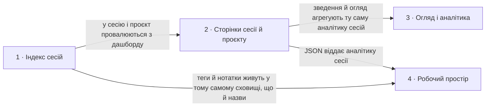

# Roadmap — agent-ops-dashboard

> **Це декомпозиція, а не обіцянка.** Ідея розбита на кілька великих кроків: що робимо, звідки
> взялася потреба і наскільки крок великий, або що на нього ще ніхто не дивився (`fog`). Дат
> немає, крім історії внизу; балів теж немає, бо пріоритет задає порядок. Кроків навмисно мало
> і вони обʼємні: кожен дає значущу річ і проходить весь конвеєр від специфікації до релізу. Саме рішення для кроку живе
> в його теці `docs/features/<slug>/`. Джерело ідеї: [`idea-brief.md`](idea-brief.md); вигляд
> задає [`design-system.md`](design-system.md).

## Destination

Розробник відкриває локальний дашборд і за хвилину розуміє, що робив coding-агент у його проєктах: знаходить сесію за назвою чи проєктом, бачить її хронологію, моделі, інструменти й оцінку вартості, а на огляді за тиждень бачить, куди пішли час і гроші, і все це без жодного запису в домашню теку агента.

## Steps

| # | Step | Source | Size | Status |
|---|---|---|:---:|---|
| 1 | [`session-index`](features/session-index/): головна сторінка як дашборд у світлій і темній темі: зведення за обраний період, графіки сесій і токенів за днями з підказками, проєкти зі спарклайнами й моделі, недавні сесії з людськими назвами, пошуком і фільтром; власні назви сесій у сховищі дашборду; закритий перелік полів журналу, які дозволено читати | `README.md` §«Яку зміну починаємо», `idea-brief.md` §1. Raw idea, §7. Recommendation | L | building |
| 2 | `session-page`: провал у сесію і в проєкт: сторінка сесії з хронологією подій без тексту розмови, аналітикою всередині сесії (моделі, токени, інструменти, оцінка вартості) і командою для продовження; сторінка проєкту з його зведенням, графіком і сесіями; переходи на них з дашборду | `idea-brief.md` §1. Raw idea, §2. Problem, §7. Recommendation, §5. Out of scope | L | idea |
| 3 | `overview`: окрема сторінка огляду за період: витрати й активність у динаміці, порівняння проєктів, моделей та інструментів, найдорожчі й найдовші сесії; оцінка витрат і сортування за вартістю на головній | `idea-brief.md` §7. Recommendation, §6. Risks, §1. Raw idea | L | idea |
| 4 | `workspace`: дашборд як робочий інструмент: теги, нотатки й закладки сесій, JSON-доступ і експорт зведень для інших інструментів | `idea-brief.md` §1. Raw idea, §3. Users, §8. Open questions | M | idea |

## Not yet specified

| Area | What we'd have to learn | Blocks | How it gets sharpened |
|---|---|:---:|---|
| Друге джерело за контрактом `registerSource` | Де інший coding-агент тримає журнали сесій, чи є там аналоги проєкту, назви, моделей і використання токенів, і чи лягає це на контракт адаптера без зміни сторінок. Кроком стане після розвідки, зараз не нумеруємо | — | Розвідка формату чужої домашньої теки на синтетичних фікстурах, потім новий рядок у Steps і `specify` |

## Out of scope

- Показ тексту розмови в будь-якому вигляді, включно з превʼю й tooltip. Дашборд показує події й числа, а не зміст; це межа приватності з [`idea-brief.md`](idea-brief.md) §5.
- Запис у `CLAUDE_HOME`. Межа стоїть у розділі «Межі» в [`AGENTS.md`](../AGENTS.md): джерело сесій лише читаємо; власні назви живуть у сховищі дашборду.
- Кілька користувачів, облікові записи й доступ по мережі. Дашборд працює на машині розробника і слухає лише `127.0.0.1`.
- Клієнтський фреймворк, збірка фронтенду, зовнішні шрифти й ресурси, нові залежності. Закріплено CSP і [`design-system.md`](design-system.md).
- Точна фінансова звітність. Вартість це оцінка за таблицею цін, позначена як оцінка.
- Редагування чи видалення сесій із дашборду.

## Open decisions

| # | Question | Type | Owner | Blocks |
|---|---|:---:|:---:|:---:|
| D3 | Чи потребує хронологія кроку 2 полів поза дозволеним переліком (`message.content` з типами блоків `tool_use` і `tool_result` без їхнього тексту), і як розширити «Межі» в `AGENTS.md` так, щоб текст лишався закритим | grilling | human | 2, 3 |
| D4 | Звідки береться таблиця цін за токен, у якому файлі живе, як оновлюється без нової залежності і що показувати для невідомої моделі | research | agent | 2 |
| D6 | Чи вкладається перше читання всіх журналів для дашборду у прийнятний час на реальній домашній теці з сотнями сесій; мемоізація в памʼяті прибирає лише повторні запити, а не перший | prototype | agent | 1, 3 |
| D7 | Задачі й трекер `docs/features/session-index/tasks/` описують лише перший, вузький обсяг; їх треба перерозбити під оновлену специфікацію | task | agent | 1 |
| D8 | Підписи осі графіка на вузькому екрані дрібні, бо SVG масштабується цілком; окремий розмір шрифту для вузького екрана або менше підписів | task | agent | 1 |
| D9 | Які пункти незалежного UI/UX-аудиту першого екрана (`docs/features/session-index/ux-audit.md` на гілці фічі) беремо в крок 1, а які лишаємо крокам 2–4 | grilling | human | 1 |

## Decisions so far

- Сесія це один файл на одному рівні; вкладені транскрипти сесіями не є → [`CONTEXT.md`](../CONTEXT.md)
- Проєкт показуємо як відновлений шлях із позначкою «похідний», доки крок 1 не дасть назву з робочої теки → [`CONTEXT.md`](../CONTEXT.md)
- Індекс будуємо з метаданих файлів; читання вмісту журналу дозволяється лише для службових полів і лише там, де специфікація прямо цього вимагає → [`AGENTS.md`](../AGENTS.md) §Межі, [`idea-brief.md`](idea-brief.md) §7
- D1: перелік сортуємо за часом зміни, потім обрізаємо; типова довжина 50, стеля 1000, неприпустиме значення пояснюємо → [`spec.md`](features/session-index/spec.md) §5 AC-04, AC-05
- D2: немає теки проєктів або вона порожня → порожній стан; нечитабельний проєкт пропускаємо і показуємо кількість → [`spec.md`](features/session-index/spec.md) §5 AC-06…AC-08
- Дизайн-канон живе в коді, позиція responsive-both, токени в `public/style.css` → [`design-system.md`](design-system.md)
- Стан інтерфейсу (ліміт, фільтри, згортання груп) живе в параметрах запиту як посилання, без клієнтського JS, поки фіча прямо його не вимагає → [`design-system.md`](design-system.md) §Interaction & writing conventions
- Вартість завжди позначена як оцінка з датою таблиці цін → [`idea-brief.md`](idea-brief.md) §5, §6
- D5: сховище дашборду це `AGENT_OPS_HOME` (типово `~/.agent-ops`), один JSON-файл назв, запис лише через `lib/store.js`; тести й demo задають тимчасову теку → [`AGENTS.md`](../AGENTS.md) §Межі, [`spec.md`](features/session-index/spec.md) §5 AC-24…AC-26
- Дозволені поля журналу: `type`, `timestamp`, `aiTitle`, `cwd`, `message.id`, `message.model`, `message.usage`; статистика мемоізується в памʼяті за розміром і mtime файла, без збереження на диск → [`AGENTS.md`](../AGENTS.md) §Межі
- Кольори проєктів призначаються за рангом активності, шість слотів, решта нейтральні; графіки інтерактивні через окремий скрипт із `public/`, без inline-коду → [`design-system.md`](design-system.md), [`spec.md`](features/session-index/spec.md) §5 AC-27…AC-30
- Темна тема: ті самі токени, переступлені під темну поверхню й перевірені валідатором палітри; іде за системою, явний вибір зберігається в браузері і застосовується до першого кадру → [`design-system.md`](design-system.md) §Token source
- Роадмап тримаємо коротким: три-чотири обʼємні кроки, кожен сам по собі корисний → [`idea-brief.md`](idea-brief.md) §6, §7

## Dependency graph

## Execution path

| Wave | Steps | Zone per step (why parallel-safe) | Unlocks |
|:---:|---|---|---|
| 1 | [`session-index`](features/session-index/): головна сторінка як дашборд у світлій і темній темі: зведення за обраний період, графіки сесій і токенів за днями з підказками, проєкти зі спарклайнами й моделі, недавні сесії з людськими назвами, пошуком і фільтром; власні назви сесій у сховищі дашборду; закритий перелік полів журналу, які дозволено читати | `README.md` §«Яку зміну починаємо», `idea-brief.md` §1. Raw idea, §7. Recommendation | L | building |
| 2 | `session-page`: провал у сесію і в проєкт: сторінка сесії з хронологією подій без тексту розмови, аналітикою всередині сесії (моделі, токени, інструменти, оцінка вартості) і командою для продовження; сторінка проєкту з його зведенням, графіком і сесіями; переходи на них з дашборду | `idea-brief.md` §1. Raw idea, §2. Problem, §7. Recommendation, §5. Out of scope | L | idea |
| 3 | `overview`: окрема сторінка огляду за період: витрати й активність у динаміці, порівняння проєктів, моделей та інструментів, найдорожчі й найдовші сесії; оцінка витрат і сортування за вартістю на головній | `idea-brief.md` §7. Recommendation, §6. Risks, §1. Raw idea | L | idea |

Друге джерело у хвилі не входить: спершу розвідка з «Not yet specified».

## Shipped

| Step | Shipped | Link |
|---|---|---|
