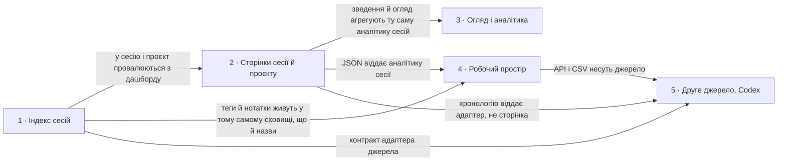

# Roadmap — agent-ops-dashboard

> **Це декомпозиція, а не обіцянка.** Ідея розбита на кілька великих кроків: що робимо, звідки
> взялася потреба і наскільки крок великий, або що на нього ще ніхто не дивився (`fog`). Дат
> немає, крім історії внизу; балів теж немає, бо пріоритет задає порядок. Кроків навмисно мало
> і вони обʼємні: кожен дає значущу річ і проходить весь конвеєр від специфікації до релізу. Саме рішення для кроку живе
> в його теці `docs/features/<slug>/`. Джерело ідеї: [`idea-brief.md`](idea-brief.md); вигляд
> задає [`design-system.md`](design-system.md).

## Destination

Розробник відкриває локальний дашборд і за хвилину розуміє, що робив coding-агент у його проєктах: знаходить сесію за назвою чи проєктом, бачить її хронологію, моделі, інструменти й оцінку вартості, а на огляді за тиждень бачить, куди пішли час і гроші, і все це без жодного запису в домашню теку агента.

## Steps

| # | Step | Source | Size | Status |
|---|---|---|:---:|---|
| 1 | [`session-index`](features/session-index/): головна сторінка як дашборд у світлій і темній темі: зведення за обраний період, графіки сесій і токенів за днями з підказками, проєкти зі спарклайнами й моделі, недавні сесії з людськими назвами, пошуком і фільтром; власні назви сесій у сховищі дашборду; закритий перелік полів журналу, які дозволено читати | `README.md` §«Яку зміну починаємо», `idea-brief.md` §1. Raw idea, §7. Recommendation | L | shipped |
| 2 | `session-page`: провал у сесію і в проєкт. Маршрути `GET /sessions/:id` і `GET /projects/:dir`. Сторінка сесії показує хронологію подій без жодного тексту розмови: запит людини, хід агента з моделлю, токенами й іменами інструментів, результат інструмента як «ок» або «помилка», компакція контексту як пара токенів до і після. Поруч аналітика всередині сесії: токени за типами, частки моделей, таблиця інструментів із кількістю викликів і помилок, маленький графік ходів, тривалість, команда `claude --resume <id>` для продовження і оцінка вартості з датою таблиці цін. Підагенти за типом і кількість та обсяг результатів інструментів беруться з вкладених тек сесії. Хронологія обрізана до 400 подій, лишається хвіст і видно примітку; аналітика рахується по всьому журналу. Сторінка проєкту повторює панелі дашборду, звужені до цього проєкту, плюс його перелік сесій. Посилання на обидві сторінки з'являються в рядках дашборду й у клітинці проєкту | `idea-brief.md` §1. Raw idea, §2. Problem, §7. Recommendation, §5. Out of scope | L | idea |
| 3 | `overview`: окрема сторінка огляду за період, маршрут `GET /overview?days=&project=`, періоди 7, 30, 90 і 365 днів, понад 90 днів графіки складаються в тижневі відра. Показує дельти до попереднього періоду такої ж довжини, вартість за відро, токени за відро складені за моделями, міні-графік за днями тижня, таблиці проєктів, моделей та інструментів і топ-10 найдорожчих і найдовших сесій із посиланнями. Ціни живуть у статичній датованій таблиці `lib/pricing.js`: ціна за мільйон токенів, поле `asOf`, невідома модель лишається без ціни. На головній додається плитка «оцінка витрат» і сортування `?sort=time\|tokens\|cost`. Мемо статистики в памʼяті виселяє ключі, яких немає в поточному скані | `idea-brief.md` §7. Recommendation, §6. Risks, §1. Raw idea | L | idea |
| 4 | `workspace`: дашборд як робочий інструмент. Сховище дашборду стає `sessions.json` виду `{id: {label, tags[], note, starred}}` з читанням старого `labels.json` лише на міграцію. Редагування переїжджає на сторінку `GET/POST /sessions/:id/edit`, а `/rename` лишається псевдонімом. Теги показані чипами й ведуть на `?tag=`, закладки на `?starred=1`. Машинний доступ це `GET /api/sessions`, `GET /api/sessions/:id` і `GET /api/overview`, зібрані з явно перелічених полів, ніколи з серіалізованого запису журналу. Експорт зведень це `GET /overview.csv?table=projects\|models\|tools\|sessions` | `idea-brief.md` §1. Raw idea, §3. Users, §8. Open questions | M | idea |
| 5 | `codex-source`: другий coding-агент як джерело. Крок сам володіє контрактом і починається з узагальнення: `registerSource` у `lib/sources.js` розширюється з нинішніх `{id, label, home}` до `{id, label, home, scan, readHead, readStats, readTimeline, readExtras}`; адаптер Claude обгортається так, щоб реалізувати цей контракт, а його функції з кроків 1–2 лишаються експортами й нікуди не переїжджають; над реєстром з'являється незалежний від джерела `lib/sessions.js`, який обходить усі зареєстровані джерела й додає кожній сесії `source: {id, label}`. Кроки 2–4 лишаються суто Claude і контракту не торкаються. Аж тоді додається адаптер Codex CLI: читає власну домашню теку `CODEX_HOME`, типово `~/.codex`, де сесії лежать як `sessions/YYYY/MM/DD/rollout-*.jsonl`, і віддає ті самі сесії, назви, робочі теки, токени, моделі й хронологію. Ідентичність сесії: id унікальний у межах свого джерела, обидва агенти дають id у формі UUID, тому ключі сховища й маршрут `/sessions/:id` лишаються голими id без префіксів; маршрут шукає id по джерелах у порядку реєстрації і бере перший збіг, а збіг id між джерелами окремо не обробляється і прийнятий як документований ризик. Рядки JSON і CSV несуть `source`, щоб споживач їх розрізняв. Дашборд, огляд і API показують обидва джерела з бейджем джерела й фільтром `?source=`. Синтетичні фікстури живуть у `fixtures/codex-home/`. Жодного коду, специфічного для одного джерела, у сторінках не з'являється | `idea-brief.md` §3. Users, §8. Open questions | L | idea |

## Not yet specified

| Area | What we'd have to learn | Blocks | How it gets sharpened |
|---|---|:---:|---|
| — | Наразі в тумані нічого немає: усе, що в обсязі, розписане кроками 1–5 | — | Новий туман з'являється тут разом із питанням, на яке ще немає відповіді |

## Out of scope

- Показ тексту розмови в будь-якому вигляді, включно з превʼю й tooltip. Дашборд показує події й числа, а не зміст; це межа приватності з [`idea-brief.md`](idea-brief.md) §5.
- Запис у `CLAUDE_HOME`. Межа стоїть у розділі «Межі» в [`AGENTS.md`](../AGENTS.md): джерело сесій лише читаємо; власні назви живуть у сховищі дашборду.
- Кілька користувачів, облікові записи й доступ по мережі. Дашборд працює на машині розробника і слухає лише `127.0.0.1`.
- Клієнтський фреймворк, збірка фронтенду, зовнішні шрифти й ресурси, нові залежності. Закріплено CSP і [`design-system.md`](design-system.md).
- Точна фінансова звітність. Вартість це оцінка за таблицею цін, позначена як оцінка.
- Редагування чи видалення сесій із дашборду.

## Open decisions

| # | Question | Type | Owner | Blocks |
|---|---|:---:|:---:|:---:|
| D6 | Чи вкладається перше читання всіх журналів для дашборду у прийнятний час на реальній домашній теці з сотнями сесій; мемоізація в памʼяті прибирає лише повторні запити, а не перший | prototype | agent | 1, 3 |
| D7 | Задачі й трекер `docs/features/session-index/tasks/` описують лише перший, вузький обсяг; їх треба перерозбити під оновлену специфікацію | task | agent | 1 |
| D8 | Підписи осі графіка на вузькому екрані дрібні, бо SVG масштабується цілком; окремий розмір шрифту для вузького екрана або менше підписів | task | agent | 1 |
| D9 | Які пункти незалежного UI/UX-аудиту першого екрана (`docs/features/session-index/ux-audit.md` на гілці фічі) беремо в крок 1, а які лишаємо крокам 2–4 | grilling | human | 1 |

## Decisions so far

- Сесія це один файл на одному рівні; вкладені транскрипти сесіями не є → [`CONTEXT.md`](../CONTEXT.md)
- Проєкт показуємо як відновлений шлях із позначкою «похідний», доки крок 1 не дасть назву з робочої теки → [`CONTEXT.md`](../CONTEXT.md)
- D1: перелік сортуємо за часом зміни, потім обрізаємо; типова довжина 50, стеля 1000, неприпустиме значення пояснюємо → [`spec.md`](features/session-index/spec.md) §5 AC-04, AC-05
- D2: немає теки проєктів або вона порожня → порожній стан; нечитабельний проєкт пропускаємо і показуємо кількість → [`spec.md`](features/session-index/spec.md) §5 AC-06…AC-08
- D3: домашню теку агента лише читаємо, а перелік дозволених полів журналу закритий; текст повідомлень не читаємо ніколи → [ADR-0001](adr/0001-read-only-agent-home-closed-field-list.md)
- D4: ціни живуть у статичній датованій таблиці `lib/pricing.js`, невідома модель лишається без ціни, кожна сума підписана як оцінка → [ADR-0007](adr/0007-pricing-static-dated-table-estimate.md)
- D5: власні дані дашборду живуть у `AGENT_OPS_HOME`, один JSON-файл, запис лише через `lib/store.js` → [ADR-0002](adr/0002-dashboard-store-outside-agent-home.md)
- Сторінки рендеряться на сервері, без фреймворка і збірки; скрипти лише з `public/`, стан сторінки в параметрах запиту → [ADR-0003](adr/0003-server-rendered-html-csp-state-in-url.md)
- Тема: один набір токенів, темна це перевизначення; типово за системою, вибір у браузері застосований до першого кадру → [ADR-0004](adr/0004-theme-same-tokens-system-first.md)
- Кольори проєктів призначаються за рангом активності, шість слотів, решта нейтральні; моделі це чотири кроки одного відтінку → [ADR-0005](adr/0005-project-colors-by-rank.md)
- Числа мемоізуються в памʼяті за шляхом, розміром і mtime; кешу на диску немає → [ADR-0006](adr/0006-in-memory-memo-no-persisted-cache.md)
- Дизайн-канон живе в коді, позиція responsive-both, токени в `public/style.css` → [`design-system.md`](design-system.md)
- Роадмап тримаємо коротким: кілька обʼємних кроків, кожен сам по собі корисний → [`idea-brief.md`](idea-brief.md) §6, §7

## Dependency graph

## Execution path

| Wave | Steps | Zone per step (why parallel-safe) | Unlocks |
|:---:|---|---|---|
| 1 | `session-index` (shipped) | `lib/claude/`, `lib/store.js`, `views/session-index.js`, `public/style.css`; єдиний крок у хвилі, паралелити нічого | Дашборд, сховище назв і закритий перелік полів журналу |
| 2 | `session-page` | Нові маршрути `/sessions/:id` і `/projects/:dir` та власні view; дашборд лише дістає посилання | Хронологія й аналітика однієї сесії |
| 3 | `overview` | Нова сторінка `/overview`, `lib/pricing.js` і плитка вартості на головній | Витрати за період і сортування за вартістю |
| 4 | `workspace` | `lib/store.js`, сторінка редагування, `/api` і `overview.csv`; єдиний крок у хвилі | Теги, нотатки, закладки й машинний доступ до чисел |
| 5 | `codex-source` | `lib/sources.js`, новий `lib/sessions.js`, `lib/codex/`, `fixtures/codex-home/`, `test/helpers.js`, `scripts/demo.mjs`, `scripts/pin-fixture-mtimes.mjs`, бейдж і фільтр джерела в `server.js` та у views. Паралельно з `workspace` не йде: `lib/sessions.js` живить `/api` з кроку 4 | Друге джерело з бейджем і фільтром, без коду під одне джерело |

## Shipped

| Step | Shipped | Link |
|---|---|---|
| session-index | 2026-09-11 | `v0.1.0` |
